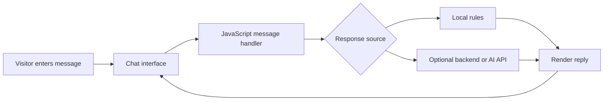

 

  

&nbsp;

&nbsp;

  

---

## 💬 Meet JavaScript Chatbot Web App

**JavaScript Chatbot Web App** is a browser-focused chatbot project concept that brings conversational interfaces into a familiar web environment. It is an approachable starting point for exploring how a chat UI can receive messages, display responses, and support interactive experiences without forcing users to learn a complicated interface.

Whether you are studying frontend development, prototyping a customer-support assistant, or experimenting with conversational design, a JavaScript chatbot offers a practical way to connect interface design with application logic.

> **The idea:** make conversations easy to start, easy to follow, and easy to adapt to your own project.

## ✨ Why Build with a Web Chatbot?

| Advantage | Why it matters |
|:--|:--|
| 🌐 **Browser-first experience** | Users can interact through a familiar web interface. |
| ⚡ **Responsive interactions** | JavaScript can update conversation elements without full-page reloads. |
| 🎨 **Flexible presentation** | Chat bubbles, colors, spacing, and layout can be tailored to your brand. |
| 🧩 **Expandable architecture** | A frontend can be connected to rule-based logic, a backend, or an AI service. |
| 🛠️ **Developer-friendly learning** | A practical way to practice DOM events, application state, and UI rendering. |
| 📱 **Adaptable layouts** | Responsive CSS can make chat experiences comfortable on different screens. |

## 🧭 Where a Chatbot Fits

<table>
<tr>
<td width="50%" valign="top">

### 🛍️ Customer Experiences

- Answer frequently asked questions
- Guide visitors toward useful resources
- Prototype product-discovery conversations

</td>
<td width="50%" valign="top">

### 🧑‍💻 Developer Projects

- Explore chat-interface design patterns
- Practice JavaScript event handling
- Experiment with conversational workflows

</td>
</tr>
<tr>
<td valign="top">

### 📚 Learning & Education

- Create interactive study assistants
- Demonstrate basic natural-language flows
- Teach frontend state management

</td>
<td valign="top">

### 🧪 Product Prototyping

- Test new assistant concepts
- Explore onboarding experiences
- Validate a conversation-first UI

</td>
</tr>
</table>

---

## 🖥️ Interface Preview

## 🚀 Get the Project

Ready to explore **JavaScript Chatbot Web App**? Use the project button below to access the provided download page.

After obtaining the project, review its included files and setup instructions. The exact launch steps depend on the implementation and any backend services it uses.

## 🧠 Understanding the Chat Flow

The following is a **conceptual architecture**, not a verified diagram of the downloadable project's internals.

A chatbot can start with a simple message handler and grow into a richer experience with server-side logic, external data, or language models. This separation helps developers keep the interface independent from the response engine.

## 🎯 Ideas to Make It Your Own

| Customization | Potential improvement |
|:--|:--|
| 🎭 Conversation themes | Light and dark modes, branded message bubbles |
| ⌨️ Input experience | Enter-to-send, multiline messages, typing feedback |
| 🗂️ Conversation history | Optional saved sessions or recent-message lists |
| 🔎 Helpful actions | Suggested prompts and quick-reply buttons |
| ♿ Accessibility | Keyboard navigation and clear screen-reader labels |
| 🔐 Secure integrations | Server-side API keys and controlled request handling |

## 💡 Practical Design Tips

**Keep the conversation readable.** Distinguish incoming and outgoing messages, maintain comfortable spacing, and show when a response is pending.

**Design for small screens.** Make input controls reachable, avoid oversized message bubbles, and check long-message wrapping.

**Treat responses as untrusted text.** Render user and model output safely instead of inserting arbitrary HTML into the page.

**Make failure states useful.** When a service is unavailable, provide a retry action or a clear explanation rather than leaving the interface silent.

---

## ❓ Frequently Asked Questions

<b>What is JavaScript Chatbot Web App?</b>

It is a web chatbot project centered on a JavaScript-driven conversational interface. Its exact included features depend on the downloadable implementation.

<b>Can it be customized?</b>

Web chatbot interfaces can generally be customized through their HTML, CSS, and JavaScript source when those files are available and editable.

<b>Does it require an AI API?</b>

Not necessarily. Some chatbots use predefined rules, while others call backend services or AI APIs. Check the downloaded project's documentation to determine its requirements.

<b>Can it work on mobile devices?</b>

A web chatbot can support mobile browsers with responsive styling. Mobile compatibility for this particular download has not been verified.

<b>Where can I get the project?</b>

Use any of the download or project-access buttons in this README.

---

### Your next conversation starts here.

  

**💬 Build interfaces that turn messages into experiences.**

